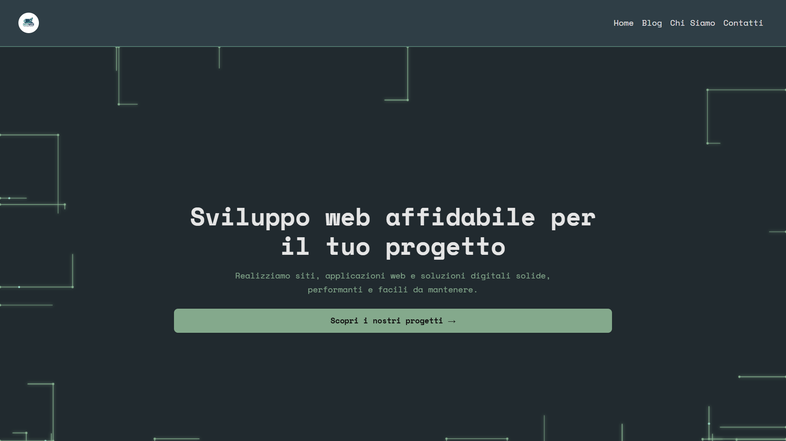
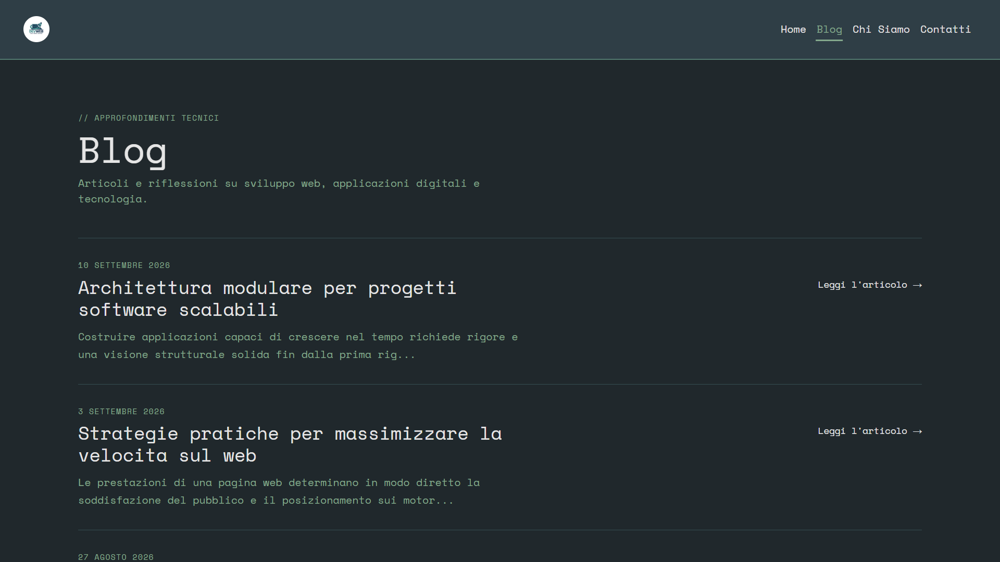
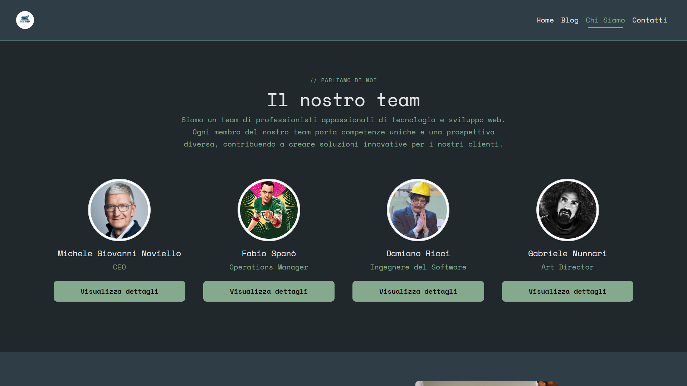
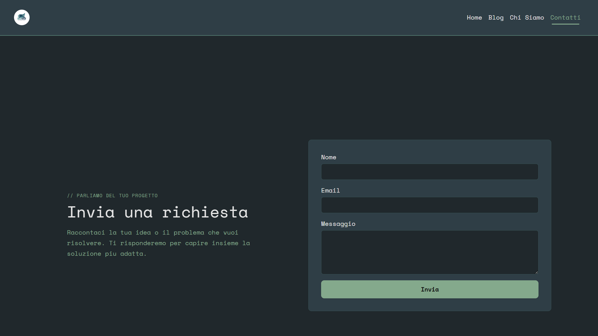

# startup-website



Multi-page company website built with Laravel: defined routes with dedicated controllers and views rendered through reusable Blade templates with a shared layout. The application includes a blog section with article detail pages backed by in-memory data, along with an About Us team directory. A contact form validates user submissions on the server, creates a mailable notification, and delivers it to Mailtrap for local email inspection. An automated test suite covers the primary route flows.

## Screenshots






## Installation and setup

```bash
composer setup
npm run dev
```

Or manually:

```bash
composer install
cp .env.example .env
php artisan key:generate
php artisan migrate
npm install
npm run build
php artisan serve
```
